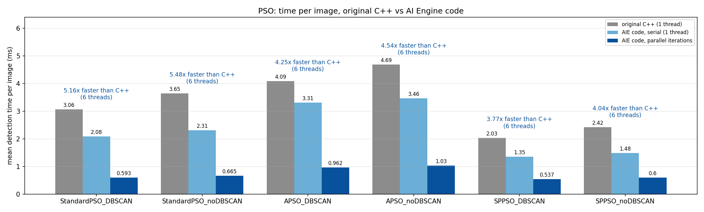
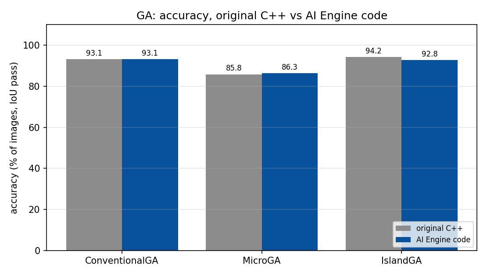

# Ellipse Detection with Swarm / Evolutionary Algorithms on AMD Versal AI Engines

This repository ports four metaheuristic ellipse detectors (**GA**, **PSO**, **ACO** and **ABC**)
from their original C++ / Python research code to the **AMD Versal AI Engine (AIE)**
array, using the Vitis ADF graph programming model. Each port is checked against the
original code for accuracy, and timed against it per image.

| Folder | Algorithm | Variants ported | Worker tiles |
|---|---|---|---|
| [`GA_AIE/`](GA_AIE) | Genetic Algorithm | Conventional GA, Micro GA, Island GA | 1 master + 30 workers |
| [`PSO_AI_Engine/`](PSO_AI_Engine) | Particle Swarm Optimisation | Standard PSO, APSO, SP-PSO (each with and without DBSCAN) | 1 master + 25 workers |
| [`ACO_Aiengine/`](ACO_Aiengine) | Ant Colony Optimisation | FPED (factorised pheromone), Standard ACO | 1 master + 30 workers |
| [`ABC_AI_Engine/`](ABC_AI_Engine) | Artificial Bee Colony | HA-ABC (hollowness-aware), SR-ABC (standard residual) | 1 master + 30 workers |

**Target:** Versal VC1902 (AIE1), Vitis 2024.2. **Dataset:** 1000 synthetic 20×20 grayscale
images, one ellipse each (`data/Ellipses_1000_images.csv` + `data/annotations.json`).

---

## 1. How the AIE code was designed

### Goal: run one image faster, not many images at once

The parallelism is applied **inside the detection of one image**, that is, inside each
iteration or generation of the algorithm. It is *not* applied by processing several
images side by side. The images go through the graph one after another, and each image's
swarm, population or colony is spread across many AIE tiles.

### Graph structure (the same in all four projects)

```
                       +--> Worker 0   --+
                       +--> Worker 1   --+
images --> Master -----+--> ...        --+--> pktmerge --+
 (PLIO)     |          +--> Worker N-1 --+               |
            |   (one broadcast int32 stream: commands)   |
            +<-------------------------------------------+
            |   (worker replies, packet-merged into one stream)
            +--> results (PLIO: 13 result words + convergence history per image)
```

- **One graph iteration = one image.** The master kernel receives a 416-byte image record
  (a 16-byte header plus 400 pixels) over a 32-bit PLIO.
- **The master** extracts the edge or hit points (plus DBSCAN, or Canny for SR-ABC), seeds
  the population and runs the algorithm loop. In each iteration it **broadcasts** the shared
  state (the global best, the population, the pheromone trails or the bee table) to every
  worker over one stream.
- **The workers** (one AIE tile each, set with `runtime<ratio> = 0.9`) all build and score
  their share of the candidates at the same time. Candidate `i` goes to worker `i % W`.
- **A `pktmerge`** collects the worker replies into one packet stream back to the master,
  which reduces them (new best, elitism, migration, trail update, and so on).
- **The variant is chosen at build time** (`GA_VARIANT`, `PSO_VARIANT`, `ACO_VARIANT`,
  `ABC_VARIANT` in `src/kernels/include.h`), so only one algorithm runs at a time.

How the work is split in each project:

| Project | What runs in parallel in each iteration |
|---|---|
| GA | Children of a generation are built and scored across 30 workers. In Island GA, each worker evolves one island and the master handles migration. |
| PSO | Each worker owns particles `w, w+25, …` and moves and scores them. SP-PSO also broadcasts its ring table. |
| ACO | Trail phase: workers 0–4 each own one FPED pheromone trail (h, k, a, b, θ). Score phase: 30 ants are scored at once. |
| ABC | Employed, onlooker and scout phases: one bee per worker (30 bees). |

### Source layout (per project)

```
src/project.h, project.cpp     ADF graph + x86sim/aiesim main()
src/kernels.h                  Master / Worker kernel classes and the stream protocol
src/kernels/include.h          image/result formats, variant + algorithm parameters
src/kernels/*_core.h           the detection algorithm itself (shared by AIE and native builds)
src/kernels/*_math.h, *_types.h  float maths and state structs that fit in tile memory
src/kernels/*_detectors.cc     Master/Worker kernel implementations
bench/reference_cpp.cpp        times the ORIGINAL research C++ code (unmodified)
bench/*_bench.cpp              the same *_core.h compiled natively: 1 thread or T threads
scripts/                       input generation, x86sim run, timing, evaluation, figures
```

The ABC research code exists only in Python, so `ABC_AI_Engine/bench/reference_cpp.cpp`
is a line-by-line C++ port of it. `scripts/run_python_reference.py` also runs the original
Python scripts so they can be compared, and the Canny edge detector in `abc_canny.h` was
checked to match OpenCV on all 1000 frames (`scripts/check_canny.py`).

### Workflow

```bash
# 1. Build image records, compile for x86sim, simulate, evaluate (per variant)
<Project>/scripts/run_x86sim.sh [vi ...]

# 2. Timing: original C++  vs  AIE code serial  vs  AIE code with T threads
<Project>/scripts/compare_timing.sh [THREADS=6] [vi ...]

# 3. Figures: compiled ADF graph, timing, accuracy, per-image detection/convergence
<Project>/scripts/make_figures.sh
```

The evaluation (`scripts/evaluate.py`) follows the reference `Evaluation.h`. It computes the
IoU of the filled detected and ground-truth ellipses, and an image **passes if IoU > 0.7**.
An image with no detection counts as a failure. Per-image results, including the time per
image for every implementation, are written to `results/<Variant>/table/<Variant>_results.csv`,
and the totals are written to `results/summary.csv`.

### How the timing was measured

This workstation has no AIE hardware build licence, so only the **x86 simulator** was
available. x86sim is a functional model that runs the kernels largely one after another,
so its wall time **cannot show the parallel speed-up**. Instead, the timing comparison
runs the *same* detection code (`*_core.h`) natively in three ways:

1. **Reference C++.** The original research detectors, single-threaded, in double precision.
2. **AIE code, serial.** The AIE detection code with 1 thread doing all of the work.
3. **AIE code, parallel.** The same code with **6 threads inside each iteration**,
   splitting the candidates the same way the graph splits them over its worker tiles.

The serial and parallel modes give identical detections, because each candidate has its
own random stream and ties are broken by the lowest index. The timed span is detection
only (edge extraction, clustering, seeding and the search), with no file I/O.

---

## 2. Results (1000 images)

### Accuracy (AIE code compared with the original implementation)

| Algorithm | Variant | AIE code pass rate | AIE mean IoU | Original pass rate | Original mean IoU |
|---|---|---:|---:|---:|---:|
| GA  | Conventional GA       | 93.1 % | 0.797 | 93.1 % | 0.795 |
| GA  | Micro GA              | 86.3 % | 0.748 | 85.8 % | 0.745 |
| GA  | Island GA             | 92.8 % | 0.800 | 94.2 % | 0.801 |
| PSO | Standard PSO + DBSCAN | 93.4 % | 0.804 | 94.2 % | 0.803 |
| PSO | Standard PSO          | 93.0 % | 0.803 | 93.2 % | 0.796 |
| PSO | APSO + DBSCAN         | 94.2 % | 0.805 | 93.5 % | 0.802 |
| PSO | APSO                  | 93.2 % | 0.802 | 92.7 % | 0.794 |
| PSO | SP-PSO + DBSCAN       | **94.9 %** | 0.804 | 94.2 % | 0.804 |
| PSO | SP-PSO                | 94.6 % | 0.804 | 94.6 % | 0.802 |
| ACO | FPED                  | 93.0 % | 0.804 | 95.3 % | 0.808 |
| ACO | Standard ACO          | 50.6 % | 0.683 | 52.3 % | 0.682 |
| ABC | HA-ABC                | 94.4 % | **0.809** | 93.8 % (Python: 94.1 %) | 0.810 |
| ABC | SR-ABC                | 20.7 % | 0.460 | 21.0 % (Python: 20.4 %) | 0.461 |

**Summary:** the AIE ports **match the original implementations to within about 2 percentage
points**. The remaining differences come from single-precision floats and different random
number streams, not from changes to the algorithms. The weak scores of Standard ACO and
SR-ABC are also present in the original code: they are baseline variants in their studies.

### Detection time per image (mean, ms)

| Algorithm | Variant | Original C++ | AIE code (1 thread) | AIE code (6 threads) | Speed-up vs original |
|---|---|---:|---:|---:|---:|
| GA  | Conventional GA       | 33.73 | 22.93 | 7.16 | 4.7× |
| GA  | Micro GA              |  2.08 |  1.84 | 0.80 | 2.6× |
| GA  | Island GA             | 19.05 | 16.00 | 4.86 | 3.9× |
| PSO | Standard PSO + DBSCAN |  3.06 |  2.08 | 0.59 | 5.2× |
| PSO | Standard PSO          |  3.65 |  2.31 | 0.67 | 5.5× |
| PSO | APSO + DBSCAN         |  4.09 |  3.31 | 0.96 | 4.3× |
| PSO | APSO                  |  4.69 |  3.46 | 1.03 | 4.5× |
| PSO | SP-PSO + DBSCAN       |  2.03 |  1.35 | 0.54 | 3.8× |
| PSO | SP-PSO                |  2.42 |  1.48 | 0.60 | 4.0× |
| ACO | FPED                  |  3.23 |  1.19 | 0.46 | 7.0× |
| ACO | Standard ACO          |  0.29 |  0.12 | 0.13 | 2.3× |
| ABC | HA-ABC                |  2.73 |  0.90 | 0.68 | 4.0× (≈580× vs Python, 395 ms) |
| ABC | SR-ABC                |  9.67 |  2.36 | 0.88 | **11.0×** (≈4100× vs Python, 3640 ms) |

What the timing shows:

- **The AIE-style restructuring is faster even on one thread.** Moving to single-precision,
  fixed-size, tile-friendly code makes it 1.1 to 4.1 times faster than the original C++.
- **Splitting each iteration across workers adds a further 1.3 to 3.5 times** with 6 host
  threads. The gain is largest for GA and PSO, which have many candidates per iteration.
  Standard ACO gains nothing: its iterations are too small, so the thread hand-off costs
  more than it saves.
- **The overall speed-up over the original C++ ranges from 2.3× to 11×.** These numbers
  come from a 6-thread CPU model of the graph. On real silicon, each of the 26 to 31 tiles
  runs independently at about 1 GHz, so the hardware figure should be measured with
  `aiesimulator` or on a board once a build licence is available.

### x86 simulator runs

Every graph was compiled with the AIE compiler (`build/x86sim_<Variant>`) and run in
`x86simulator`, and its detections were scored with the same `evaluate.py`. For ABC, the
x86sim result records were also checked word by word against the native build
(`scripts/compare_x86sim_bench.py`). Simulation wall times are in `results/timing_x86sim.csv`:
for example, PSO took 179 to 1106 s for 1000 images, and GA and ABC took 785 to 1502 s
for 100 to 1000 images. These times reflect the simulator, not the device.

### Figures

Each project's `report_figures/` folder contains the compiled ADF graph for every variant
(`adf_graph_<Variant>.png/.svg`), `timing_mean.png`, `timing_per_image.png`, `accuracy.png`
and the algorithm-specific accuracy, evaluation-count and IoU histograms. The per-image
detection and convergence plots are written to `results/<Variant>/figures/`.

| PSO timing | GA accuracy |
|---|---|
|  |  |

---

## 3. Requirements

- AMD Vitis 2024.2 (`/tools/Xilinx/Vitis/2024.2/settings64.sh`, or set `VITIS_SETTINGS`)
- `g++` with C++17 and pthreads for the native benchmarks
- Python 3 standard library for input generation and evaluation; matplotlib (in
  `~/.venvs/aie_plots`) for the figures; numpy, OpenCV and Pillow only for the ABC Python reference
- The original research code next to this folder, for the reference timings
  (the PSO variant repository, `GaCppPython`, `ACO`, `ABC`)
